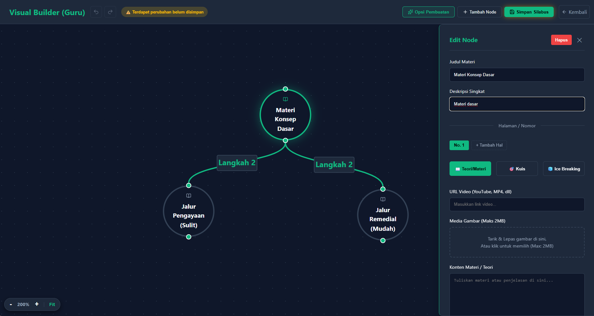
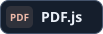
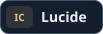
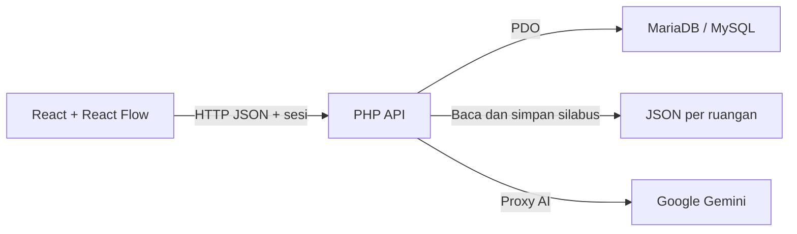

# FlacTopus AI

<p></p>

<p>
  
  
  
  
  
  
</p>

[Tentang proyek](#tentang-proyek) · [Fitur utama](#fitur-utama) · [Teknologi](#teknologi-yang-dipakai) · [Cara instalasi](#cara-instalasi) · [Arsitektur](#arsitektur-sistem) · [Referensi teknis](#referensi-teknis)

## Tentang proyek

FlacTopus AI adalah prototipe pembelajaran untuk **OSCAR 3.0 Web Development** karya tim Webdev 2 SMK TI Dwiguna.

Kami mulai dari tujuan dalam satu kelas. Murid perlu menuntaskan dasar sebelum lanjut, dan guru perlu melihat pola jawaban untuk menentukan topik yang perlu diulas. Saat kelas pindah topik menurut jadwal yang sama, murid yang masih kesulitan bisa tertinggal.

<p></p>

**Peran tim.** Raja Purwanto merencanakan proyek dan mengerjakan UI/UX alur guru, murid, dan admin. Satu rekan membantu mengembangkan ide dan memberi masukan desain. Rekan lainnya menangani keamanan aplikasi.

## Fitur utama

### Guru · susun peta dan evaluasi kelas

[](./docs/images/builder.png)

Guru menyusun node dengan *drag-and-drop* atau memulai dari template linear, bercabang, atau ujian akhir. Generator Gemini bisa membuat draf dari topik, teks, atau isi PDF. Satu node dapat memuat beberapa halaman **Materi**, **Kuis**, dan **Ice Breaking**.

Di analitik, **Materi Tersulit** menunjukkan rata-rata nilai per topik. **Soal Sering Salah** memperlihatkan sebaran pilihan pada satu pertanyaan. Guru bisa memakai keduanya untuk memilih topik yang akan diulang dan memulai diskusi tentang alasan murid memilih jawaban tertentu.

<p align="center">
  <a href="./docs/images/analitik-materi.webp"></a>
  <a href="./docs/images/analitik-soal.webp"></a>
</p>

<details>
<summary><strong>Lihat partisipasi dan Asisten AI Guru</strong></summary>

Dashboard juga memuat partisipasi, tren rata-rata nilai, dan leaderboard. **Eksplorasi Silabus → Edit di Builder** langsung memusatkan editor pada node yang dicari. Guru mengelola anggota kelas dan dapat meminta ringkasan serta saran tindak lanjut dari **Asisten AI Guru**, yang memakai konteks analitik kelas.

<p align="center">
  <a href="./docs/images/partisipasi.webp"></a>
  <a href="./docs/images/asisten-guru.webp"></a>
</p>

</details>

### Murid · ikuti prasyarat dan coba lagi

[](./docs/images/socratic-boss.webp)

Murid bergabung dengan kode kelas enam karakter. Peta membuka node lanjutan ketika semua prasyaratnya memiliki hasil tercatat. Pada soal nonaudio, **Socratic Tutor** dirancang memberi pertanyaan penuntun setelah jawaban keliru. Tombol **Tanya AI** saat membaca materi adalah pendamping terpisah dari panel umpan balik kuis.

<details>
<summary><strong>Lihat peta murid, empat format kuis, dan Ice Breaking</strong></summary>

<p align="center">
  <a href="./docs/images/skill-tree-murid.webp"></a>
  <a href="./docs/images/tipe-kuis.webp"></a>
</p>

**Pilihan ganda** memilih satu jawaban. **Isi rumpang** menyusun blok kata. **Boss Fight** menambahkan nyawa dan pertarungan pada pilihan ganda. **Auditori** memutar audio sebelum murid menjawab. Pada **Ice Breaking**, murid mengenali suara tiga maskot lalu menebak satu suara yang diputar secara acak.

[](./docs/images/ice-breaking.webp)

</details>

### Admin · kelola akses

<details>
<summary><strong>Lihat panel admin</strong></summary>


Pendaftaran mandiri membuat akun murid berstatus `pending`. Admin meninjau pendaftaran, dapat mengubah peran, memulihkan ruangan yang dihapus, dan memeriksa log aktivitas.

</details>

> Selama kuis, browser mencatat perpindahan tab sebagai sinyal yang bisa ditinjau guru. Angka pada cuplikan berasal dari kelas demo.

## Teknologi yang dipakai

<p>
  
  
  
  
  
  
</p>

| Bagian | Teknologi | Dipakai untuk |
| --- | --- | --- |
| Antarmuka | JavaScript/JSX, HTML, CSS, React 19, React DOM, React Router 7, Lucide React | Halaman guru, murid, dan admin, navigasi SPA, serta ikon. |
| Editor dan grafik | React Flow (`@xyflow/react`), Recharts | Node dan relasi prasyarat, grafik partisipasi, nilai, dan distribusi jawaban. |
| Animasi dan media | Framer Motion, Rive (`@rive-app/react-canvas`), canvas-confetti, Web Audio API, HTMLAudio, embed YouTube | Transisi, maskot interaktif, efek penyelesaian node, suara kuis, dan video materi. |
| Dokumen dan konten | PDF.js (`pdfjs-dist`), DOMPurify | Mengambil teks PDF untuk draf silabus dan menyaring HTML pada pratinjau materi. |
| Server dan data | PHP 8 native, sesi PHP, PDO, MariaDB/MySQL, JSON, Apache/XAMPP | API kelas, autentikasi, migrasi, hasil kuis, penyimpanan graf silabus, dan routing Apache. |
| Integrasi AI | Google Gemini REST API, PHP cURL, Fetch API | Browser memanggil API PHP. Server mengirim permintaan Gemini untuk tutor, asisten, dan generator silabus. |
| Perkakas pengembangan | Node.js, npm, Vite 8, plugin React untuk Vite, Oxlint, tipe React/React DOM, GitHub Actions | Menjalankan dan membangun frontend, lint, bantuan tipe di editor, serta pemindaian secret di CI. |

<details>
<summary><strong>Lihat kredit pustaka dan aset</strong></summary>

**tsParticles** tercantum di kredit beranda. Efek yang dipanggil kode pada versi ini memakai **canvas-confetti**. Paket `@google/generative-ai` tercantum di manifest, sedangkan jalur Gemini yang dipakai aplikasi melalui proxy PHP. [Kredit beranda](./frontend/src/pages/Landing.jsx) · [Manifest frontend](./frontend/package.json) · [Proxy Gemini](./backend/controller/api/gemini.php)

Kredit aset Rive dicatat di beranda sebagai **CC BY 4.0**.

- **Octopus Loop** oleh pedroalpera. [Aset Rive](https://rive.app/community/files/4974-10065-octopus-loop/)
- **Smiley Stress Reliever** oleh jodunson. [Aset Rive](https://rive.app/marketplace/16938-41043-smiley-stress-reliever/)
- **Animojis** oleh very_true_story. [Aset Rive](https://rive.app/marketplace/27832-52591-animojis/)

</details>

## Cara instalasi

1. Siapkan **XAMPP** dan **Node.js 24 LTS**. Nyalakan **Apache** dan **MySQL** di XAMPP.
2. Di GitHub pilih **Code → Download ZIP**. Ubah nama folder hasil ekstrak menjadi `FlacTopus`, lalu taruh di `C:\xampp\htdocs`. Pastikan jalurnya `C:\xampp\htdocs\FlacTopus\frontend`. Kalau proyek sudah ada di sana, langsung gunakan folder itu.
3. Buka **Command Prompt (CMD)** dan jalankan blok berikut.

```
cd /d "C:\xampp\htdocs\FlacTopus"
if not exist "auth\config.php" copy "auth\config.example.php" "auth\config.php"
"C:\xampp\php\php.exe" "db\migration.php"
cd frontend
npm.cmd ci
npm.cmd run dev
```

Buka [localhost:5173/FlacTopus/](http://localhost:5173/FlacTopus/) dan biarkan terminal berjalan. Kalau folder proyek dan frontend sudah siap dan yang perlu disiapkan hanya database, jalankan baris `migration.php` dari folder `FlacTopus`. Migrasi membuat database `project_lomba`, tabel, dan akun demo pada instalasi kosong.

<details>
<summary><strong>Aktifkan Gemini bila diperlukan</strong></summary>

Untuk mencoba tutor generatif, generator silabus, atau asisten AI, isi `GEMINI_API_KEY` di `auth/config.php` dengan kunci dari [Google AI Studio](https://aistudio.google.com/apikey). PHP memerlukan ekstensi `curl` dan koneksi internet. Simpan konfigurasi berkunci di luar commit. Alur kelas, editor manual, dan pencatatan kuis dapat dicoba dengan konfigurasi dasar.

</details>

<details>
<summary><strong>Build untuk dibuka langsung lewat Apache</strong></summary>

Jalankan dari folder `C:\xampp\htdocs\FlacTopus\frontend` setelah `npm.cmd ci`.

```powershell
npm.cmd run build
if ($LASTEXITCODE -ne 0) { throw 'Build gagal' }
Set-Location ..
Get-ChildItem -LiteralPath '.\frontend\dist' -Force |
  Where-Object Name -ne '.htaccess' |
  ForEach-Object { Copy-Item -LiteralPath $_.FullName -Destination . -Recurse -Force }
```

Buka [localhost/FlacTopus/](http://localhost/FlacTopus/). Langkah salin mempertahankan `.htaccess` di root dan menempatkan `index.html`, `node-assets/`, serta aset publik hasil build di folder aplikasi. `bash build.sh` menyediakan alur serupa untuk lingkungan Bash dengan `rsync`. Commit perubahan pada sumber `frontend/`.

</details>

## Cara penggunaan

| Peran demo lokal | Email | Password |
| --- | --- | --- |
| Guru | `guru@example.com` | `password123` |
| Murid | `murid@example.com` | `password123` |
| Admin | `admin@example.com` | `password123` |

1. Masuk sebagai **Guru**, buka kelas `TREE01`, lalu buat atau pilih template di **Editor Skill Tree**. Isi node dengan materi dan satu soal, kemudian klik **Simpan Silabus**. Migrasi membuat kelas demo. Isi silabus disimpan saat guru menyimpannya.
2. Masuk sebagai **Murid** dari sesi browser terpisah. Buka kelas demo yang sudah diikuti, pilih node yang tersedia, lalu selesaikan kuis.
3. Kembali sebagai **Guru**. Buka **Analitik Kelas**, muat ulang data, dan telusuri **Materi Tersulit** atau **Soal Sering Salah** setelah ada hasil.

<details>
<summary><strong>Jika instalasi tersendat</strong></summary>

| Gejala | Yang perlu dicek |
| --- | --- |
| Vite tampil, login atau API gagal | Nyalakan Apache. Cocokkan port Apache dengan target proxy di `frontend/vite.config.js`. Pastikan URL berawal dari `/FlacTopus/`. |
| Migrasi gagal menyambung ke database | Cek layanan MySQL, ekstensi `pdo_mysql`, dan kredensial di `db/migration.php` serta `auth/config.php`. Default lokal memakai `root` tanpa password di port `3306`. |
| Halaman Apache kosong atau 404 | Jalankan build dan salin hasilnya ke folder aplikasi. Pastikan Apache membaca `.htaccess` dan `mod_rewrite` aktif. Jika rute dalam gagal saat dimuat ulang di XAMPP, sesuaikan `RewriteBase` lokal menjadi `/FlacTopus/`. |
| Silabus gagal disimpan | Pastikan Apache punya akses tulis ke `storage/ruangan/`. |
| PDF atau video gagal dibuka di build Apache | Cek aturan Content Security Policy untuk sumber worker PDF.js atau iframe video. |
| Gemini gagal merespons | Cek kunci di konfigurasi lokal, ekstensi `curl`, koneksi internet, serta kuota/model Gemini. |

Jika memindahkan kelas yang sudah terisi, pindahkan juga cadangan database dan folder `storage/ruangan/`. File JSON di folder itu menyimpan isi dan relasi node.

</details>

## Arsitektur sistem



| Lapisan | Lokasi dan peran |
| --- | --- |
| Antarmuka | [`frontend/src/pages/`](./frontend/src/pages/) memuat halaman untuk guru, murid, dan admin. React Router mengatur rute. React Flow menampilkan node dan relasi. |
| Visual dan interaksi | [`frontend/src/components/`](./frontend/src/components/) memuat editor, kuis, grafik Recharts, dan animasi Rive. |
| Autentikasi dan API | [`auth/`](./auth/) menangani sesi. [`backend/controller/api/`](./backend/controller/api/) melayani permintaan JSON dan proxy Gemini. |
| Logika dan data | [`backend/controller/logic/`](./backend/controller/logic/) menangani logika kelas, registrasi, pembatasan login, dan audit. [`db/migration.php`](./db/migration.php) menyiapkan skema. Graf silabus disimpan di `storage/ruangan/<id>.json`. |

## Referensi teknis

<details>
<summary><strong>Hak akses, sesi, dan batas prototipe</strong></summary>

| Peran | Akses utama |
| --- | --- |
| Guru pemilik kelas | Membuat kelas, mengatur anggota, menyimpan silabus, dan membaca analitik. |
| Murid | Bergabung dengan kode, membaca silabus kelasnya, dan mengerjakan kuis. |
| Ketua kelas | Anggota dengan hak tambahan pada pengelolaan dan analitik kelas sesuai pemeriksaan API. |
| Admin sistem | Meninjau akun, mengubah peran, memeriksa log, dan menangani ruangan terhapus. |

Implementasi mencakup password bcrypt, cookie sesi HttpOnly, token CSRF untuk aksi tulis, pembatasan percobaan login, dan log aktivitas. Lihat [autentikasi](./auth/auth.php), [pembatasan login](./backend/controller/logic/RateLimiter.php), dan [aturan Apache](./.htaccess).

UI mengatur pembukaan node. Browser menghitung nilai dan hitungan pindah tab sebelum hasil dikirim. Analitik dapat dipakai sebagai bahan evaluasi pembelajaran, dengan interpretasi dan tindak lanjut di tangan guru.

</details>

<details>
<summary><strong>Skema database dan endpoint</strong></summary>

| Tabel | Data |
| --- | --- |
| `users`, `ruangan`, `class_members` | Akun, pemilik kelas, kode gabung, peran dan keanggotaan kelas. |
| `syllabus` | Referensi silabus per kelas. Isi node dan relasi berada di JSON. |
| `quiz_attempts` | Hasil kuis per murid dan node, termasuk pilihan jawaban dan hitungan pindah tab. |
| `login_attempts`, `activity_log`, `schema_version` | Pembatasan login, audit aktivitas, dan riwayat versi migrasi. |

| Endpoint | Contoh penggunaan |
| --- | --- |
| [`auth/`](./auth/) | Login, registrasi, logout, dan pembacaan sesi untuk React. |
| [`ruangan.php`](./backend/controller/api/ruangan.php) | Daftar ruangan, `GET ?action=members&id=1`, `GET ?action=syllabus&id=1`, dan aksi tulis kelas. |
| [`quiz.php`](./backend/controller/api/quiz.php) | Simpan hasil melalui `POST`. Baca analitik melalui `GET ?action=analytics&ruangan_id=1` atau progres murid melalui `GET ?action=student_progress&ruangan_id=1`. |
| [`admin.php`](./backend/controller/api/admin.php) | Kelola pengguna, ruangan terhapus, dan log aktivitas. |
| [`gemini.php`](./backend/controller/api/gemini.php) | Proxy server untuk petunjuk kuis, asisten belajar, asisten guru, dan generator silabus. |

</details>

## Kontribusi

Fork repo, buat branch perubahan, dan ajukan pull request. Jalankan `npm.cmd run lint` dari `frontend/` sebelum mengajukan perubahan. Proyek menggunakan [GNU GPL v3](./LICENSE).

