# FlacTopus AI

<p>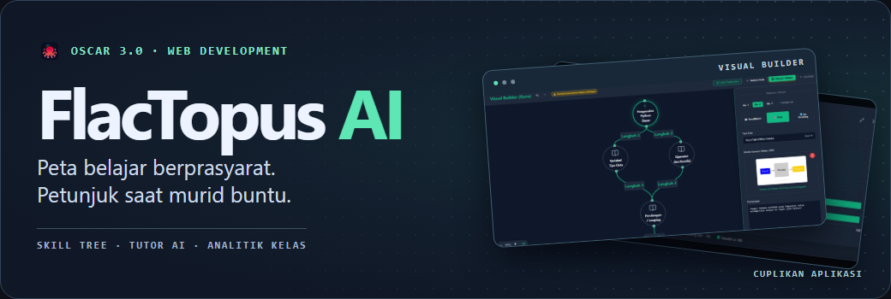</p>

<p>
  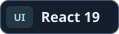
  
  
  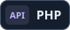
  
  
</p>

[Tentang proyek](#tentang-proyek) · [Fitur utama](#fitur-utama) · [Cara instalasi](#cara-instalasi) · [Arsitektur](#arsitektur-sistem) · [Referensi teknis](#referensi-teknis)

## Tentang proyek

FlacTopus AI adalah prototipe pembelajaran untuk **OSCAR 3.0 Web Development** karya tim Webdev 2 SMK TI Dwiguna.

Kami mulai dari tujuan dalam satu kelas. Murid perlu menuntaskan dasar sebelum lanjut, dan guru perlu melihat pola jawaban untuk menentukan topik yang perlu diulas. Saat kelas pindah topik menurut jadwal yang sama, murid yang masih kesulitan bisa tertinggal.

<p>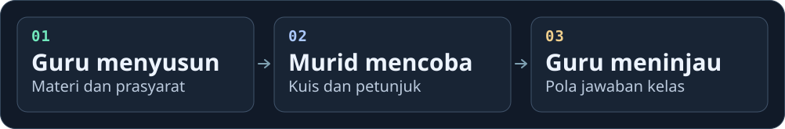</p>

**Peran tim.** Raja Purwanto merencanakan proyek dan mengerjakan UI/UX alur guru, murid, dan admin. Satu rekan membantu mengembangkan ide dan memberi masukan desain. Rekan lainnya menangani keamanan aplikasi.

## Fitur utama

### Guru · susun peta dan evaluasi kelas

[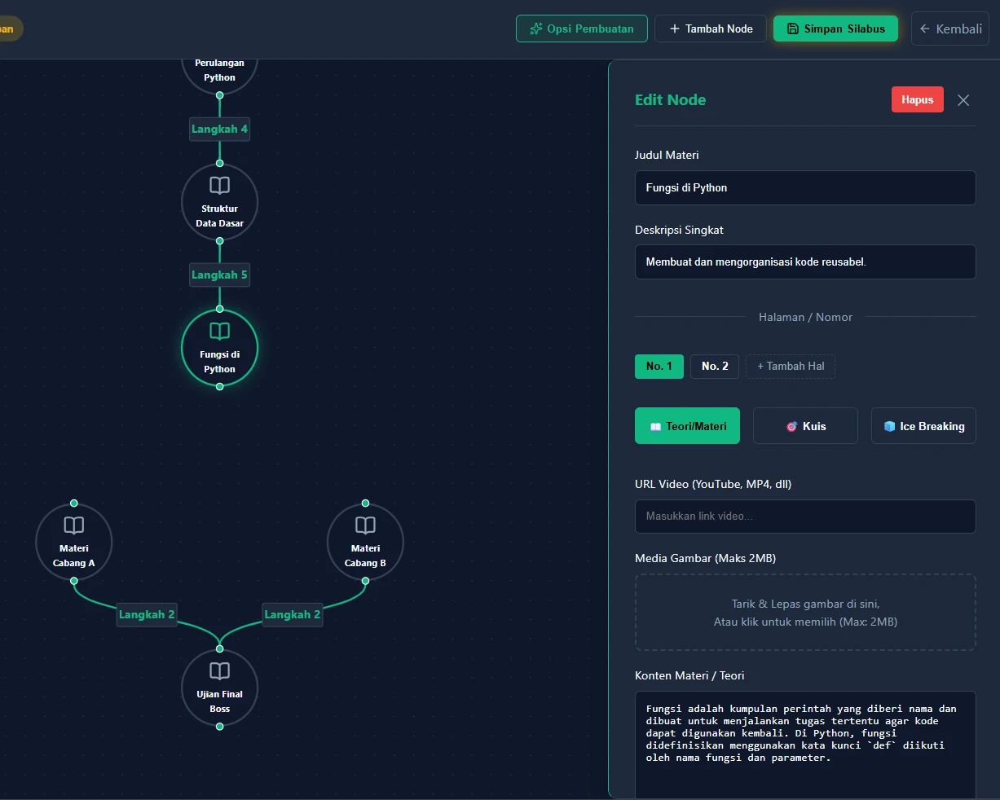](./docs/images/builder.webp)

Guru menyusun node dengan *drag-and-drop* atau memulai dari template linear, bercabang, atau ujian akhir. Generator Gemini bisa membuat draf dari topik, teks, atau isi PDF. Satu node dapat memuat beberapa halaman **Materi**, **Kuis**, dan **Ice Breaking**.

Di analitik, **Materi Tersulit** menunjukkan rata-rata nilai per topik. **Soal Sering Salah** memperlihatkan sebaran pilihan pada satu pertanyaan. Guru bisa memakai keduanya untuk memilih topik yang akan diulang dan memulai diskusi tentang alasan murid memilih jawaban tertentu.

<p align="center">
  <a href="./docs/images/analitik-materi.webp">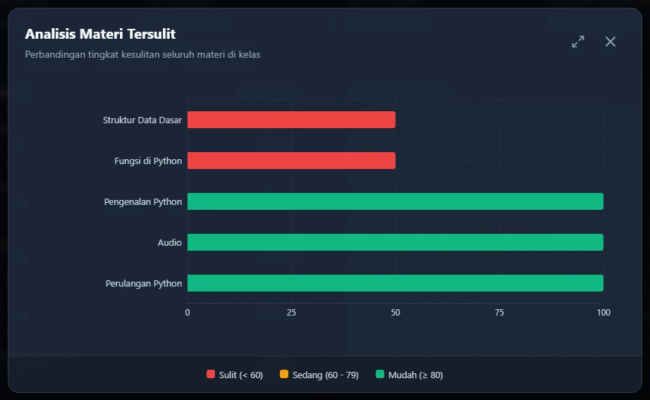</a>
  <a href="./docs/images/analitik-soal.webp">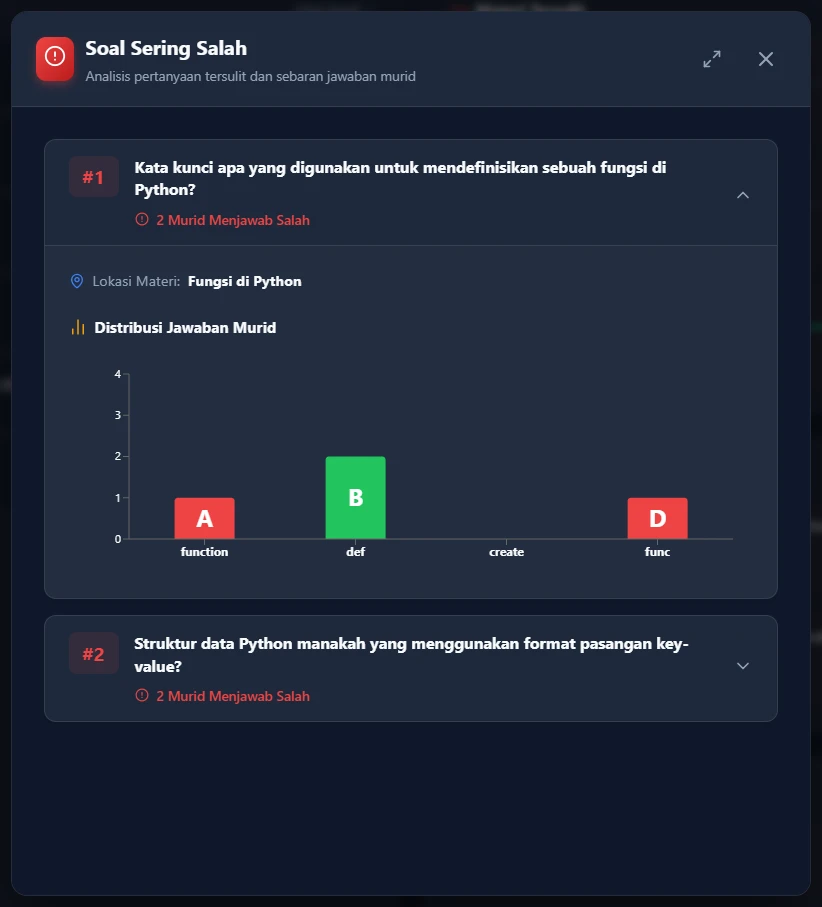</a>
</p>

<details>
<summary><strong>Lihat partisipasi dan Asisten AI Guru</strong></summary>

Dashboard juga memuat partisipasi, tren rata-rata nilai, dan leaderboard. **Eksplorasi Silabus → Edit di Builder** langsung memusatkan editor pada node yang dicari. Guru mengelola anggota kelas dan dapat meminta ringkasan serta saran tindak lanjut dari **Asisten AI Guru**, yang memakai konteks analitik kelas.

<p align="center">
  <a href="./docs/images/partisipasi.webp">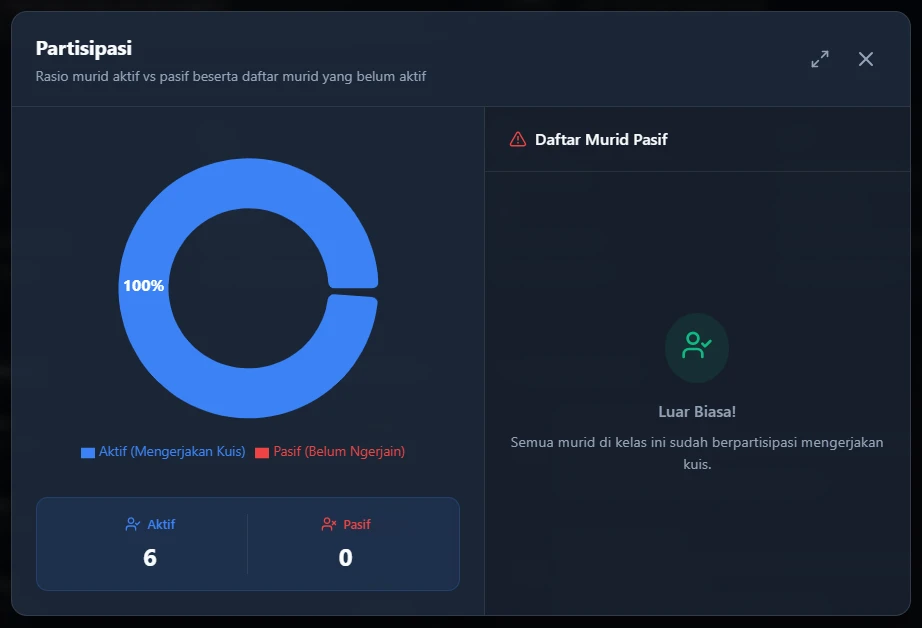</a>
  <a href="./docs/images/asisten-guru.webp">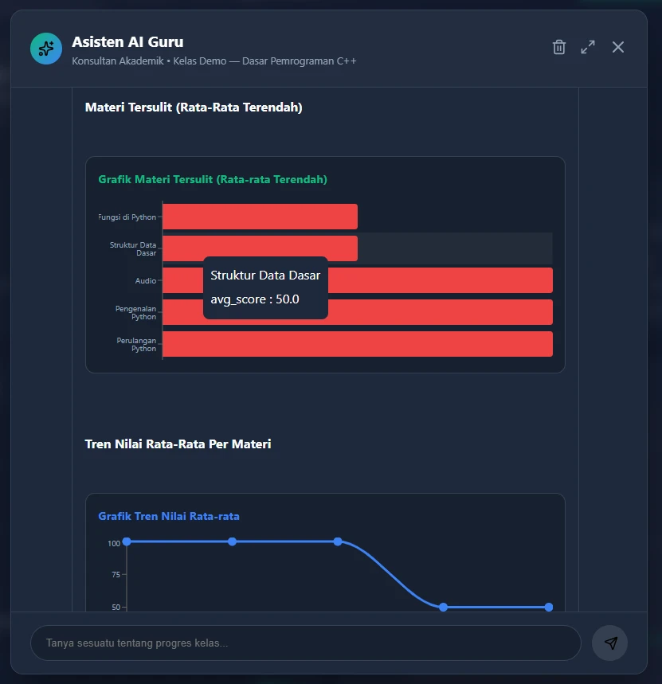</a>
</p>

</details>

### Murid · ikuti prasyarat dan coba lagi

[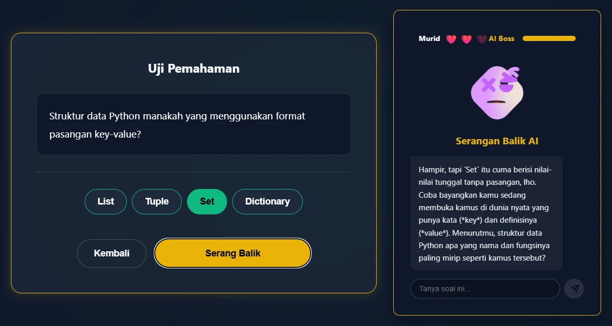](./docs/images/socratic-boss.webp)

Murid bergabung dengan kode kelas enam karakter. Peta membuka node lanjutan ketika semua prasyaratnya memiliki hasil tercatat. Pada soal nonaudio, **Socratic Tutor** dirancang memberi pertanyaan penuntun setelah jawaban keliru. Tombol **Tanya AI** saat membaca materi adalah pendamping terpisah dari panel umpan balik kuis.

<details>
<summary><strong>Lihat peta murid, empat format kuis, dan Ice Breaking</strong></summary>

<p align="center">
  <a href="./docs/images/skill-tree-murid.webp">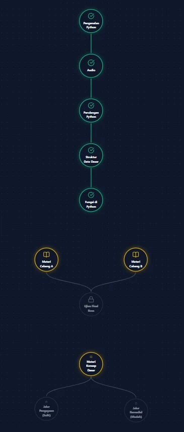</a>
  <a href="./docs/images/tipe-kuis.webp">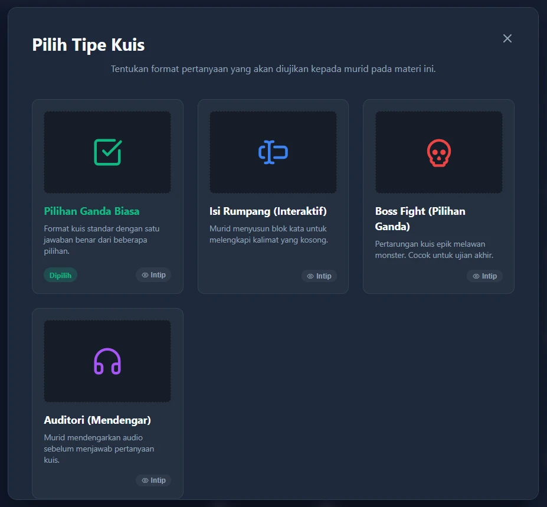</a>
</p>

**Pilihan ganda** memilih satu jawaban. **Isi rumpang** menyusun blok kata. **Boss Fight** menambahkan nyawa dan pertarungan pada pilihan ganda. **Auditori** memutar audio sebelum murid menjawab. Pada **Ice Breaking**, murid mengenali suara tiga maskot lalu menebak satu suara yang diputar secara acak.

[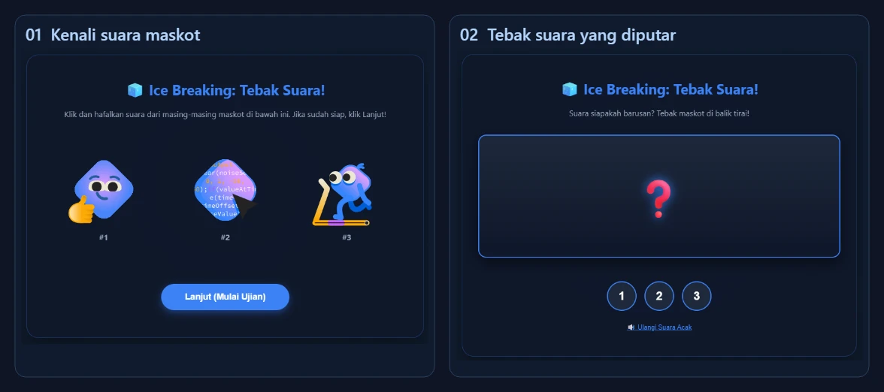](./docs/images/ice-breaking.webp)

</details>

### Admin · kelola akses

<details>
<summary><strong>Lihat panel admin</strong></summary>

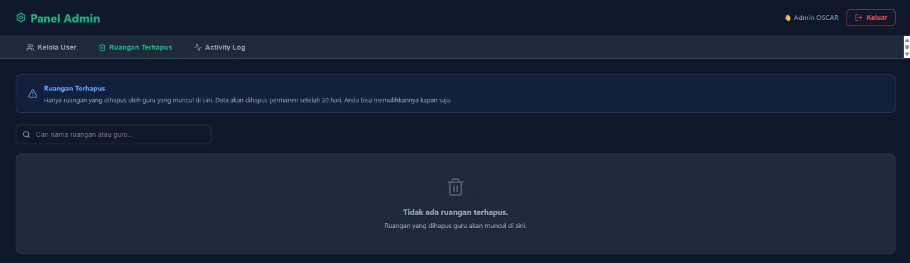

Pendaftaran mandiri membuat akun murid berstatus `pending`. Admin meninjau pendaftaran, dapat mengubah peran, memulihkan ruangan yang dihapus, dan memeriksa log aktivitas.

</details>

> Selama kuis, browser mencatat perpindahan tab sebagai sinyal yang bisa ditinjau guru. Angka pada cuplikan berasal dari kelas demo.

## Cara instalasi

### Prasyarat

- Windows dengan **XAMPP**. Nyalakan **Apache** di port `80` dan **MySQL/MariaDB** di port `3306`. Siapkan PHP 8.x dengan `pdo_mysql`. Fitur Gemini memerlukan `curl` PHP dan koneksi internet.
- **Node.js 24 LTS** dan npm. Node 22 juga memenuhi syarat paket proyek mulai dari **22.13**. Siapkan Git untuk langkah klon.

### 1. Siapkan folder, konfigurasi, dan database

Jalankan di PowerShell. Nama folder `FlacTopus` mengikuti base path Vite dan konfigurasi Apache.

```powershell
Set-Location 'C:\xampp\htdocs'
git clone https://github.com/RajaPurwa2810-Mpry/FlacTopus-finall.git FlacTopus
Set-Location .\FlacTopus
Copy-Item .\auth\config.example.php .\auth\config.php
& 'C:\xampp\php\php.exe' .\db\migration.php
```

Migrasi CLI membuat database `project_lomba`, tabel hingga versi **v6**, dan akun demo pada instalasi kosong. Default lokal memakai pengguna database `root` dengan password kosong. Jika koneksi database berbeda, sesuaikan pengaturan pada `auth/config.php` dan `db/migration.php` sebelum menjalankan migrasi.

### 2. Jalankan frontend dengan Vite

```powershell
Set-Location .\frontend
npm.cmd ci
npm.cmd run dev
```

Buka [localhost:5173/FlacTopus/](http://localhost:5173/FlacTopus/). Vite menjalankan React dan meneruskan permintaan PHP ke Apache. Biarkan Apache, MySQL, dan terminal Vite berjalan.

### 3. Aktifkan Gemini bila diperlukan

Isi `GEMINI_API_KEY` di salinan lokal `auth/config.php` dengan kunci dari [Google AI Studio](https://aistudio.google.com/apikey). Simpan file konfigurasi lokal di luar commit. Alur kelas, editor manual, dan pencatatan kuis dapat dicoba dengan konfigurasi dasar. Tutor generatif, generator silabus, dan asisten AI memerlukan kunci valid.

<details>
<summary><strong>Build untuk dibuka langsung lewat Apache</strong></summary>

Jalankan dari folder `C:\xampp\htdocs\FlacTopus\frontend` setelah `npm.cmd ci`.

```powershell
npm.cmd run build
if ($LASTEXITCODE -ne 0) { throw 'Build gagal' }
Set-Location ..
Get-ChildItem -LiteralPath '.\frontend\dist' -Force |
  Where-Object Name -ne '.htaccess' |
  ForEach-Object { Copy-Item -LiteralPath $_.FullName -Destination . -Recurse -Force }
```

Buka [localhost/FlacTopus/](http://localhost/FlacTopus/). Langkah salin mempertahankan `.htaccess` di root dan menempatkan `index.html`, `node-assets/`, serta aset publik hasil build di folder aplikasi. `bash build.sh` menyediakan alur serupa untuk lingkungan Bash dengan `rsync`. Commit perubahan pada sumber `frontend/`.

</details>

## Cara penggunaan

| Peran demo lokal | Email | Password |
| --- | --- | --- |
| Guru | `guru@example.com` | `password123` |
| Murid | `murid@example.com` | `password123` |
| Admin | `admin@example.com` | `password123` |

1. Masuk sebagai **Guru**, buka kelas `TREE01`, lalu buat atau pilih template di **Editor Skill Tree**. Isi node dengan materi dan satu soal, kemudian klik **Simpan Silabus**. Migrasi membuat kelas demo. Isi silabus disimpan saat guru menyimpannya.
2. Masuk sebagai **Murid** dari sesi browser terpisah. Buka kelas demo yang sudah diikuti, pilih node yang tersedia, lalu selesaikan kuis.
3. Kembali sebagai **Guru**. Buka **Analitik Kelas**, muat ulang data, dan telusuri **Materi Tersulit** atau **Soal Sering Salah** setelah ada hasil.

<details>
<summary><strong>Jika instalasi tersendat</strong></summary>

| Gejala | Yang perlu dicek |
| --- | --- |
| Vite tampil, login atau API gagal | Nyalakan Apache. Cocokkan port Apache dengan target proxy di `frontend/vite.config.js`. Pastikan URL berawal dari `/FlacTopus/`. |
| Migrasi gagal menyambung ke database | Cek layanan MySQL, ekstensi `pdo_mysql`, dan kredensial pada file migrasi serta konfigurasi aplikasi. |
| Halaman Apache kosong atau 404 | Jalankan build dan salin hasilnya ke folder aplikasi. Pastikan Apache membaca `.htaccess` dan `mod_rewrite` aktif. Jika rute dalam gagal saat dimuat ulang di XAMPP, sesuaikan `RewriteBase` lokal menjadi `/FlacTopus/`. |
| Silabus gagal disimpan | Pastikan Apache punya akses tulis ke `storage/ruangan/`. |
| Gemini gagal merespons | Cek kunci di konfigurasi lokal, ekstensi `curl`, koneksi internet, serta kuota/model Gemini. |

</details>

## Arsitektur sistem

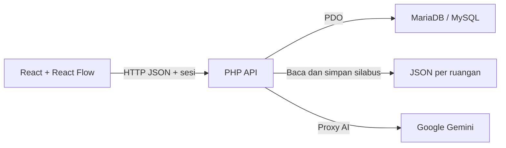

| Lapisan | Lokasi dan peran |
| --- | --- |
| Antarmuka | [`frontend/src/pages/`](./frontend/src/pages/) memuat halaman untuk guru, murid, dan admin. React Router mengatur rute. React Flow menampilkan node dan relasi. |
| Visual dan interaksi | [`frontend/src/components/`](./frontend/src/components/) memuat editor, kuis, grafik Recharts, dan animasi Rive. |
| Autentikasi dan API | [`auth/`](./auth/) menangani sesi. [`backend/controller/api/`](./backend/controller/api/) melayani permintaan JSON dan proxy Gemini. |
| Logika dan data | [`backend/controller/logic/`](./backend/controller/logic/) menangani logika kelas, registrasi, pembatasan login, dan audit. [`db/migration.php`](./db/migration.php) menyiapkan skema. Graf silabus disimpan di `storage/ruangan/<id>.json`. |

## Referensi teknis

<details>
<summary><strong>Hak akses, sesi, dan batas prototipe</strong></summary>

| Peran | Akses utama |
| --- | --- |
| Guru pemilik kelas | Membuat kelas, mengatur anggota, menyimpan silabus, dan membaca analitik. |
| Murid | Bergabung dengan kode, membaca silabus kelasnya, dan mengerjakan kuis. |
| Ketua kelas | Anggota dengan hak tambahan pada pengelolaan dan analitik kelas sesuai pemeriksaan API. |
| Admin sistem | Meninjau akun, mengubah peran, memeriksa log, dan menangani ruangan terhapus. |

Implementasi mencakup password bcrypt, cookie sesi HttpOnly, token CSRF untuk aksi tulis, pembatasan percobaan login, dan log aktivitas. Lihat [autentikasi](./auth/auth.php), [pembatasan login](./backend/controller/logic/RateLimiter.php), dan [aturan Apache](./.htaccess).

UI mengatur pembukaan node. Browser menghitung nilai dan hitungan pindah tab sebelum hasil dikirim. Analitik dapat dipakai sebagai bahan evaluasi pembelajaran, dengan interpretasi dan tindak lanjut di tangan guru.

</details>

<details>
<summary><strong>Skema database dan endpoint</strong></summary>

| Tabel | Data |
| --- | --- |
| `users`, `ruangan`, `class_members` | Akun, pemilik kelas, kode gabung, peran dan keanggotaan kelas. |
| `syllabus` | Referensi silabus per kelas. Isi node dan relasi berada di JSON. |
| `quiz_attempts` | Hasil kuis per murid dan node, termasuk pilihan jawaban dan hitungan pindah tab. |
| `login_attempts`, `activity_log`, `schema_version` | Pembatasan login, audit aktivitas, dan riwayat versi migrasi. |

| Endpoint | Contoh penggunaan |
| --- | --- |
| [`auth/`](./auth/) | Login, registrasi, logout, dan pembacaan sesi untuk React. |
| [`ruangan.php`](./backend/controller/api/ruangan.php) | Daftar ruangan, `GET ?action=members&id=1`, `GET ?action=syllabus&id=1`, dan aksi tulis kelas. |
| [`quiz.php`](./backend/controller/api/quiz.php) | Simpan hasil melalui `POST`. Baca analitik melalui `GET ?action=analytics&ruangan_id=1` atau progres murid melalui `GET ?action=student_progress&ruangan_id=1`. |
| [`admin.php`](./backend/controller/api/admin.php) | Kelola pengguna, ruangan terhapus, dan log aktivitas. |
| [`gemini.php`](./backend/controller/api/gemini.php) | Proxy server untuk petunjuk kuis, asisten belajar, asisten guru, dan generator silabus. |

</details>

## Kontribusi

Fork repo, buat branch perubahan, dan ajukan pull request. Jalankan `npm.cmd run lint` dari `frontend/` sebelum mengajukan perubahan. Proyek menggunakan [GNU GPL v3](./LICENSE).

